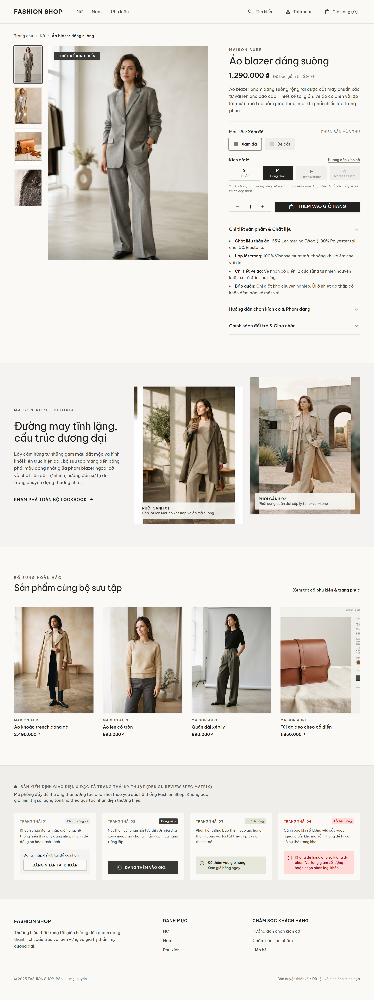
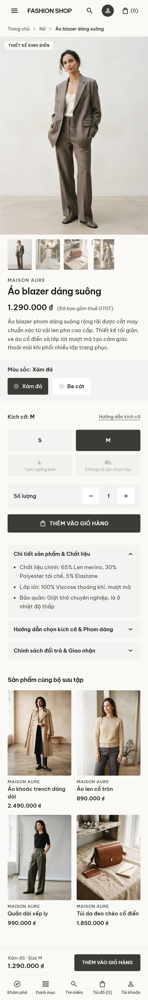
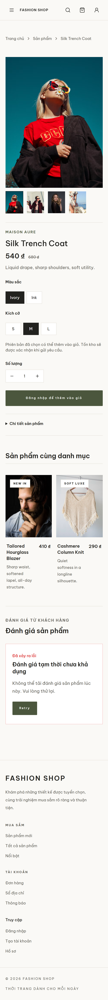

# Issue #33 design and state mapping

## Route scope

| App route | Main Stitch frame | Responsive source | Notes |
|---|---|---|---|
| `/products/:slug` | `Fashion Shop - 05 Product Detail Desktop` (`projects/15029798778414010901/screens/181f3ba78cff4c91a7e8dab8fa09d27c`) | `Fashion Shop - 06 Product Detail Mobile` (`projects/15029798778414010901/screens/bb6e87cb55004c0091bbf34dda015808`) and local `artifacts/stitch-review/index.html` PDP at the 390px breakpoint | A Stitch mobile PDP frame exists; the local responsive prototype is the supplemental source for touch behavior and mobile states, not a substitute frame. |

The route keeps the existing slug lookup. It does not add any route or API behavior.

## Route states and design references

| Route state | Stitch reference | Prototype reference | Implementation/API behavior |
|---|---|---|---|
| Loading product | No separate loading screen; the desktop frame's review matrix documents a state system | `index.html` PDP with the `loading` scenario; responsive rules in `preview.css` | Existing detail query skeleton remains, with one page heading and the slug route intact. |
| Product not found | No separate frame | `preview.js` `stateView('empty', true)` | Empty state links to the existing product list route. |
| Catalog request error and retry | No separate frame | `preview.js` `stateView('error', true)` | Existing query error and retry are kept. |
| Product loaded, no attribute selected / partial selection | Desktop and mobile Product Detail frames show the purchase panel and grouped choices | `preview.js` PDP, default and missing-size hint | Attribute groups are built from catalog `attributeId`/`valueId`; quantity and add action remain available in the same order as the reference. |
| Exact ACTIVE variant | Desktop and mobile Product Detail frames; the desktop frame also shows the selected control | `preview.js` `selected()` and PDP render | The cart request uses only the resolved exact variant ID. Effective price is sale price when present, otherwise base price. |
| INACTIVE variant | Desktop Product Detail frame's size choices and design system section `05 · Card, bộ lọc, biến thể` | `preview.js` hint `L: tạm ngừng bán` | Inactive catalog choices are visibly unavailable and cannot be added. |
| Combination not present in the returned variant matrix | Desktop Product Detail frame's unavailable size example and design system section `05 · Card, bộ lọc, biến thể` | `preview.js` hint `XL: không có lựa chọn này` | Only values supplied by the API are rendered. A combination made from independently supplied values can resolve as unavailable; the UI does not invent a value such as `XL` if the API did not return it. |
| Guest add-to-cart | Desktop frame's `Trạng thái 01`; mobile responsive PDP in the local prototype | `preview.js` guest state and login continuation | Customer-side add action redirects to the existing login route with the PDP return path. The preview's fake session is not copied. |
| Add pending / duplicate submit | Desktop frame's `Trạng thái 02` | `preview.js` pending state | Both purchase actions disable while the existing cart mutation is pending; a synchronous guard prevents a duplicate request. |
| Add success | Desktop frame's `Trạng thái 03` | `preview.js` success notice and sample cart | Existing cart mutation invalidation and success toast remain. |
| Server stock failure | Desktop frame's `Trạng thái 04` | `preview.js` `stock` scenario | PDP shows an inline error and toast while preserving selected values. No stock count is displayed or inferred. |
| Variant image, shared-image fallback, video media | Product Detail desktop/mobile frames and the media notes in `DESIGN-BRIEF-v2.md` | `preview.js` media selection | Use matching `IMAGE` media for an exact variant, otherwise shared `IMAGE` media. `VIDEO` is excluded. |
| Review loading, empty, or error | No separate PDP state frame | Local prototype's review detail and state controls | API contract takes precedence: product review reads require authentication. A guest/API error is not represented as “no reviews.” |

## Contract-led differences

- Prototype fixtures show `XL` as a sample unavailable option. The customer API returns only existing variant combinations and does not provide a complete attribute-value catalog. The implementation only renders values present in API variant attributes.
- Public PDP detail has no inventory count. The UI reports stock only through the cart API response and does not show a number before that response.
- The prototype's guest/session and cart are simulated. The implementation retains CUSTOMER authentication and the real cart mutation.
- Product review reads require authentication under `API.md`; an API authorization error is shown as an error state, not as an empty review list.

## Screenshot comparison

Reference and implementation captures are stored side by side in this folder. Desktop uses the Stitch frame's 1280 CSS-pixel width; mobile uses the 390 CSS-pixel breakpoint. Images are design review artifacts only and use the repository's existing illustrative mock catalog in local mock mode.

| Desktop | Mobile |
|---|---|
|  |  |
|  |  |

## Remaining visual differences

- Stitch uses illustrative product names, prices, variant labels, and fashion imagery. Implementation screenshots use existing local mock catalog data; changing that data solely to resemble the reference would fabricate catalog content.
- Stitch includes an editorial/lookbook section and product policy accordions. The current public detail contract supplies description and media but does not supply verified lookbook or delivery/return-policy content, so the PDP does not invent those sections.
- Stitch shows an unavailable value label such as `XL`. It is omitted unless the catalog API supplies that value; absent public catalog values cannot be synthesized in the customer UI.
- Stitch renders color swatches with visual color values. The public variant contract exposes attribute/value identifiers and labels, not a verified color code or swatch asset, so the implementation uses accessible labeled choices without guessing colors.
- The review panel screenshot records the actual local mock API authorization failure. Reviews require authentication according to `API.md`; no live API credentials or review data were used for this capture.
