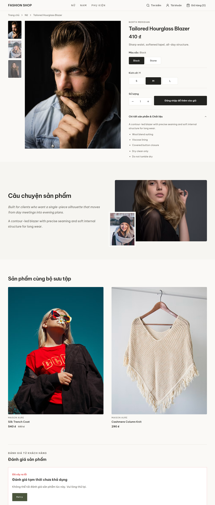

# Issue #33: product detail design mapping

## Route, states, and approved Stitch frames

The target is the approved PDP in Stitch project [`Fashion Shop · Duyệt thiết kế 01 · Be Vietnam Pro`](https://stitch.google.com/projects/15029798778414010901), not the similarly numbered frame in another project.

| Route/state | Stitch reference | Implementation behavior |
|---|---|---|
| `/products/:slug`, loaded desktop | **05 Product Detail Desktop**, screen `bb73d20b8d804861a019e6afcae99bd5`; design viewport 1280 × 3007 CSS px | API product gallery, purchase panel, details, editorial story, related items, review section and footer. Screenshot uses the same 1280 × 3007 viewport. |
| `/products/:slug`, loaded mobile | **06 Product Detail Mobile**, screen `ed757c495a284a1091355b9aa22b9855`; design viewport 390 × 3037 CSS px | Responsive gallery, variants, quantity, CTA, accordions, related grid, fixed purchase bar and bottom navigation. Screenshot uses the same 390 × 3037 viewport. |
| Loading | No separate loading frame; use the corresponding desktop/mobile PDP hierarchy | Existing product query skeleton. |
| Not found | No separate frame; retain the app's existing not-found/empty pattern | Existing not-found state and products link. |
| Product request error/retry | No separate frame; retain the app's existing error pattern | Existing query error and retry. |
| No or partial variant selection | Variant groups and order in frames 05/06 | Attribute groups/values from product detail only; add action remains guarded until an exact active variant resolves. |
| Exact active variant selected | Selected choice treatment in frames 05/06 | The existing exact variant ID resolution is preserved and submitted to the existing cart API. |
| Inactive/unavailable combination | Disabled-choice treatment in frames 05/06 | Existing inactive/unavailable options remain disabled; no unavailable options are invented. Public API does not expose inventory quantities. |
| Add to cart: guest, pending, success, API/stock error | Frames show the primary CTA; each transient outcome has no separate approved frame | Existing auth redirect, pending duplicate-submit guard, cart mutation, success feedback and API error handling. |
| Gallery media selection/fallback | Gallery and thumbnails in frames 05/06 | Existing IMAGE media filtering, selection and fallback; no video or synthetic media. |
| Review loading/empty/error | Review state panel is a design-review specimen in the Stitch artboard, not customer review data | Existing review API integration and its real loading/empty/error states remain. No sample review states are shipped. |

## Side-by-side comparison captures

The approved design source images and implementation captures are in this directory. Stitch files are 2560 × 6014 and 780 × 6074 physical pixels (DPR 2), equivalent to the CSS viewports above. Implementation captures use those same CSS viewport sizes and DPR 2, with reduced motion enabled. They load the existing local mock route `/products/tailored-hourglass-blazer`; this is visual evidence for layout and interactions, not live API evidence. The rendered local document is taller than the artboards (desktop 3363 CSS px; mobile 3755 CSS px), so these viewport captures show the top viewport and crop lower page content/footer. This height difference comes from the app's real content and API-driven review/error states; no review specimen or shorter fake page is injected to force the artboard height.

| Desktop · 1280 × 3007 CSS px | Mobile · 390 × 3037 CSS px |
|---|---|
| **Design**  **Implementation**  | **Design**  **Implementation**  |

## Mapping and remaining differences

- The page sequence, desktop gallery/purchase split, mobile stacked hierarchy, image ratios, thumbnail arrangement, variant selection controls, quantity/add action, accordion hierarchy, related-product grid, mobile sticky purchase bar, and bottom navigation are mapped to frames 05/06. Gallery selection, thumbnail dimming, image transition, hover treatment, and motion-reduced behavior use the existing UI and shared motion conventions.
- Brand, typography (Be Vietnam Pro), Fashion Shop identity and VND follow the repository contracts. Stitch uses illustrative Maison Aure product copy and photography. The implementation screenshot consequently shows the existing mock product `Tailored Hourglass Blazer`, its English catalog copy, its current media, price, and variants. These fixtures were not edited to imitate the design sample; live catalog content may differ.
- The screenshot is the logged-out state: its primary action routes to login and its desktop/mobile header account affordance follows the existing auth behavior. Stitch's sample CTA is shown as add-to-cart, so its label/action differs for a guest under the current authentication contract.
- Stitch's `THIẾT KẾ KINH ĐIỂN` badge, exact editorial story copy/media, size-guide content, and shipping/return promises have no verified product API fields or dedicated customer endpoint. The page uses only API-backed product fields/media for its story and omits unsupported claims/actions. Public product responses do not expose stock quantities, so no stock count is displayed.
- The review-state strip visible in the Stitch artboard is a review-only design specimen. It is not customer content and is not rendered. Actual reviews remain integrated through the existing API state handling. The app also keeps its existing semantic breadcrumb, related-product and review sections where they are outside or differ from the artboard's illustrative specimen.
- The approved mobile frame has four related cards while this local mock response returns two. The UI lays out the returned products in the same two-column grid and does not synthesize extra catalog items.

No API, route, validation, authentication, or commerce behavior was changed to match illustrative Stitch content. Live API results were not checked in this visual comparison.
