# Checkout visual review

Stitch screenshots are the approved frames from project `15029798778414010901`. Implementation screenshots use the matching CSS viewport widths: 1280px desktop and 390px mobile. Their viewport heights match the corresponding Stitch frame heights; images show the full page. The implementation uses isolated synthetic fixtures from `capture-checkout.mjs`; no customer account or live API was used.

| Route | Desktop: approved Stitch | Desktop: implementation | Mobile: approved Stitch | Mobile: implementation |
| --- | --- | --- | --- | --- |
| `/checkout/address` | 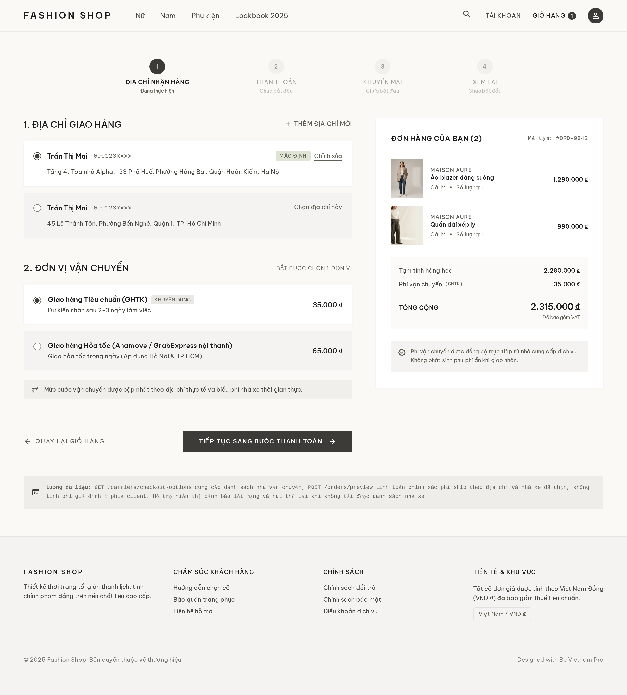 | 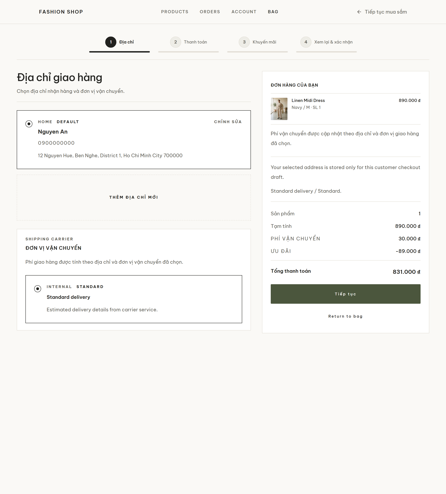 | 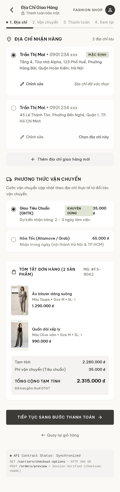 | 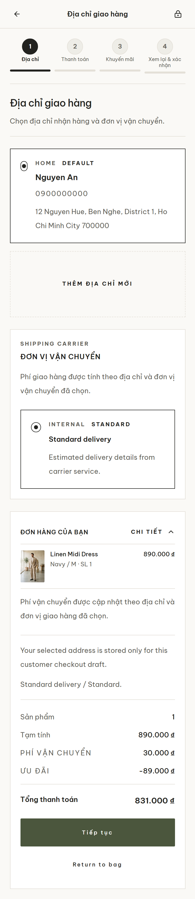 |
| `/checkout/payment` | 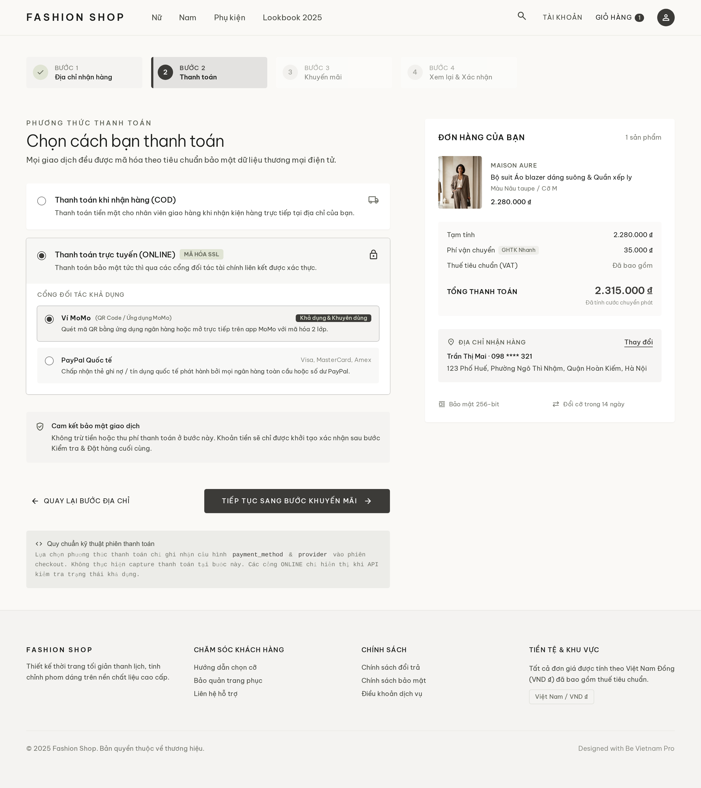 | 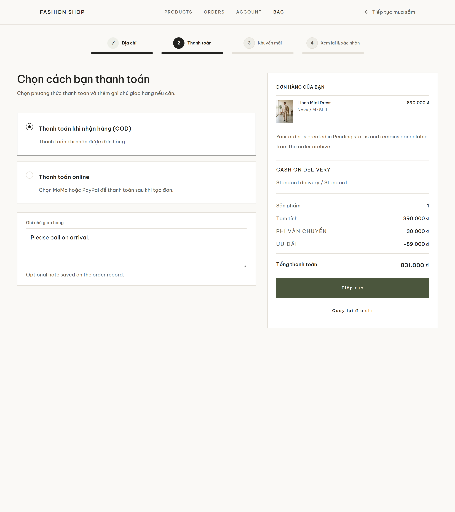 | 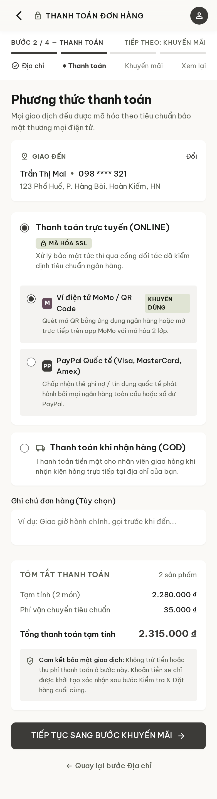 | 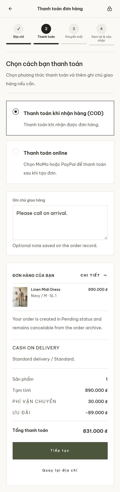 |
| `/checkout/voucher` | 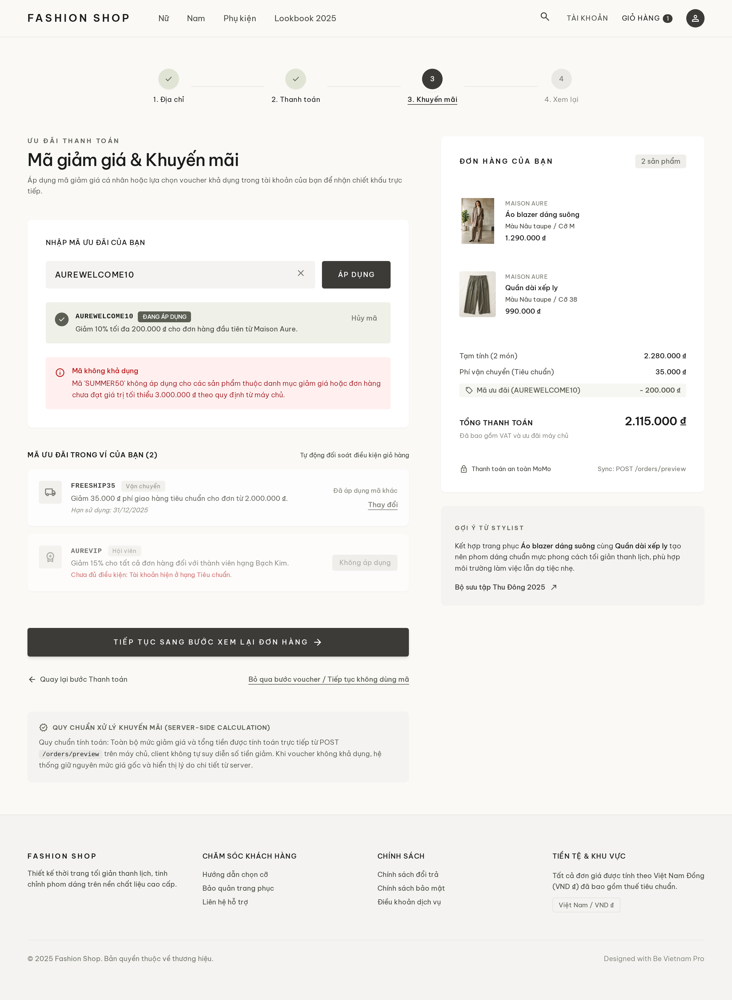 | 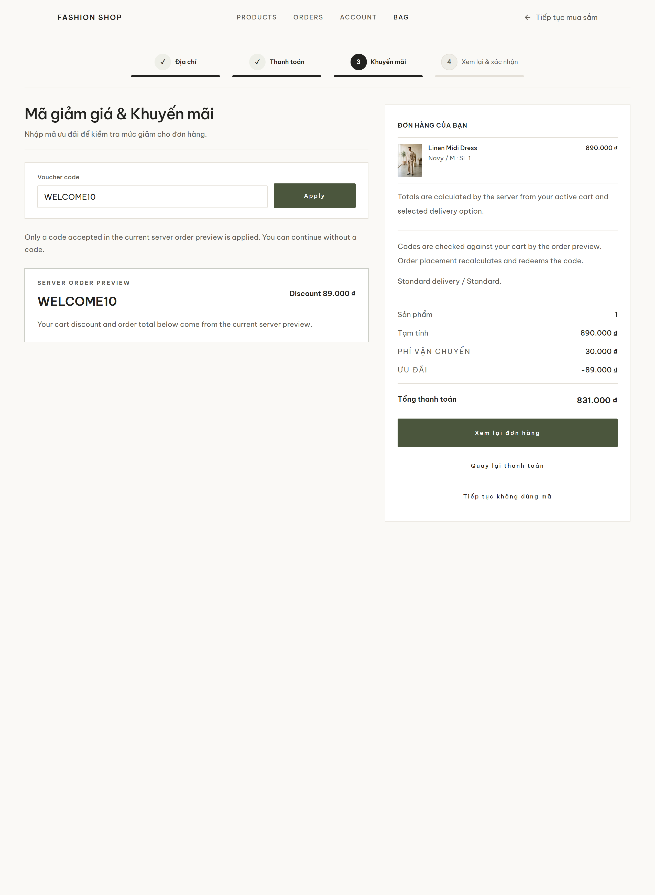 | 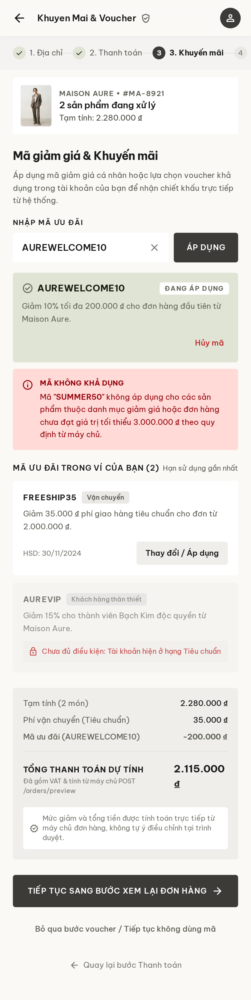 | 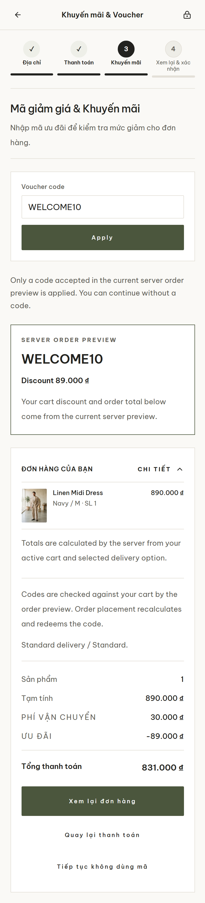 |
| `/checkout/review` | 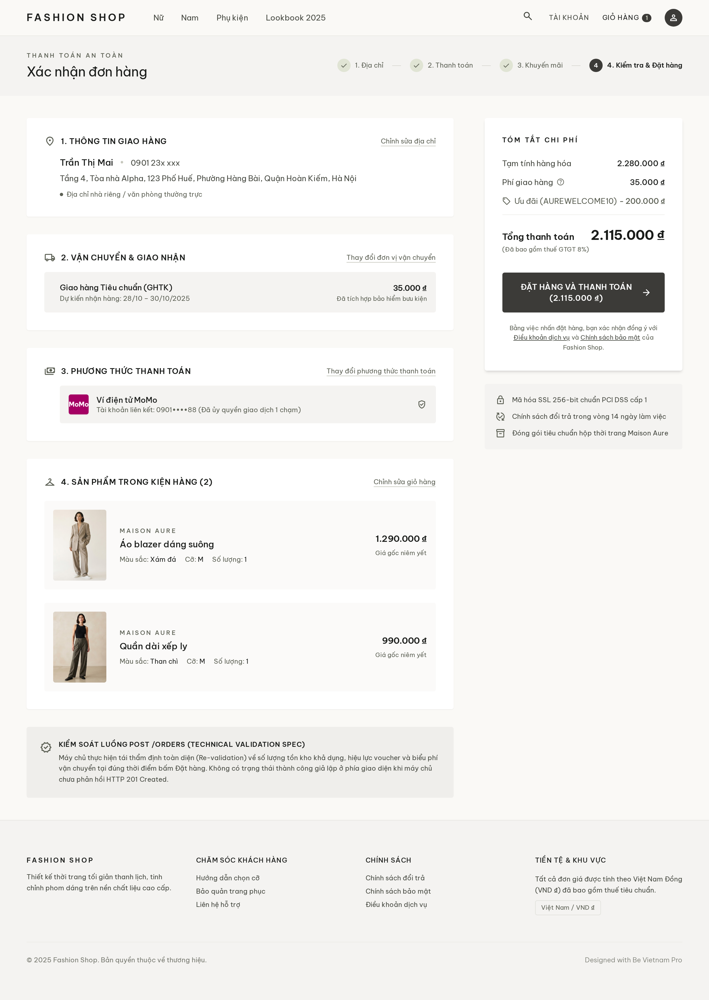 | 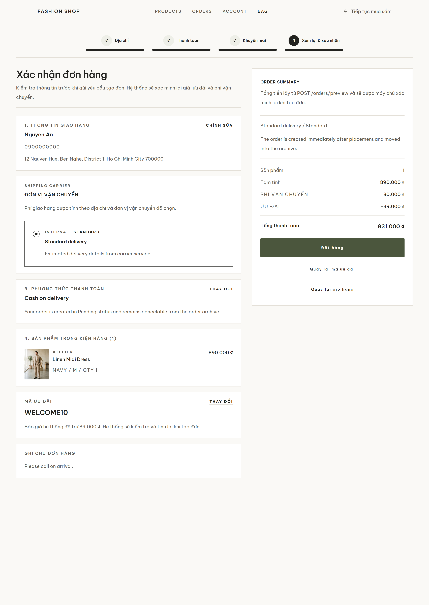 | 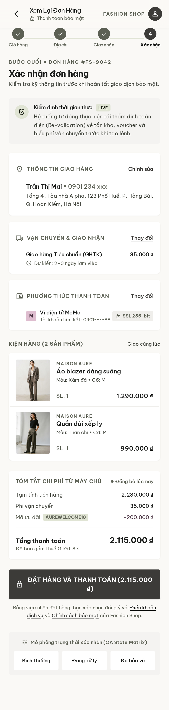 | 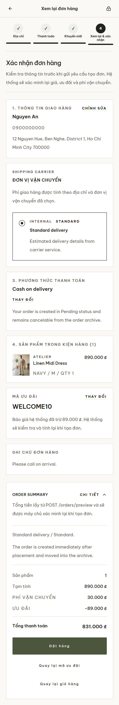 |
| `/checkout/confirmation` | 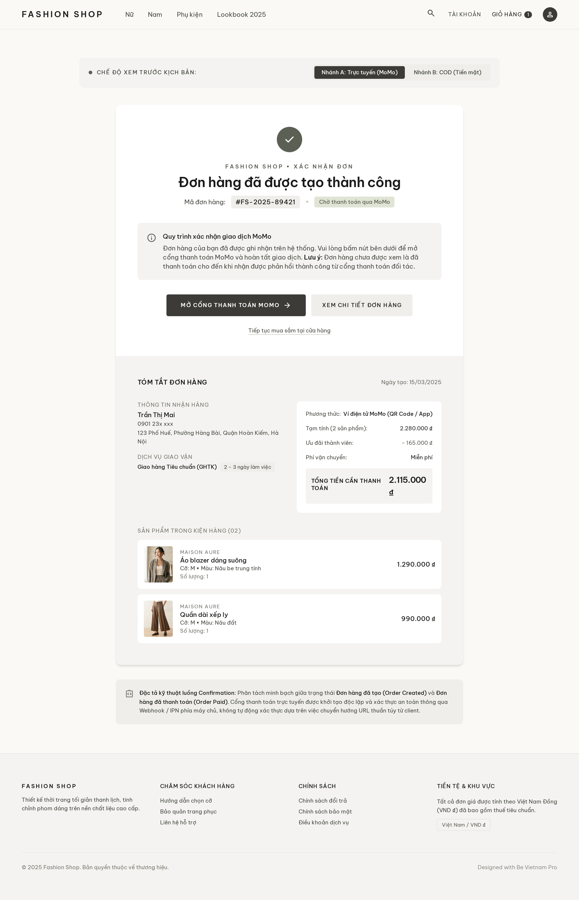 | 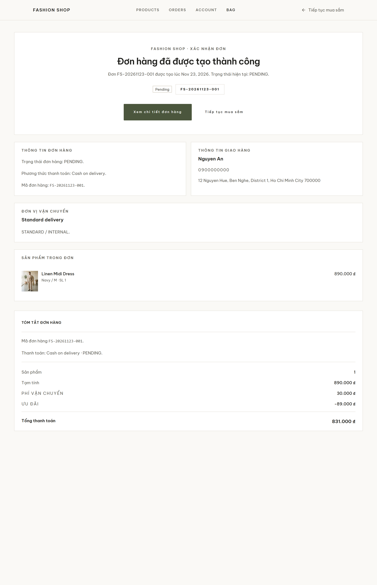 | 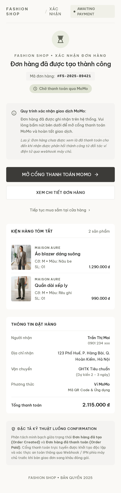 | 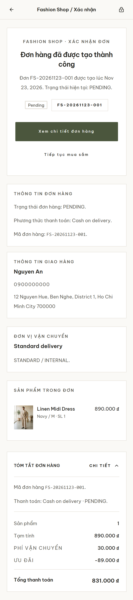 |

## Remaining differences and contract reasons

- The approved voucher frame shows wallet offers, a past-voucher error example, and fabricated promotion details. Customer APIs available to this flow expose voucher validation and server order preview, but no voucher-wallet listing. The implementation therefore shows only a code and the accepted/rejected result returned by the current preview; it does not invent offer inventory or dates.
- The address frame shows multiple addresses. The implementation renders all addresses returned by `GET /addresses`; the screenshot fixture intentionally contains one default address to keep the comparison deterministic.
- The confirmation frame uses a generic success treatment. The implementation displays the returned order and payment states because order creation can return `PENDING` / `AWAITING_PAYMENT`; it does not claim payment succeeded from order creation.
- The desktop checkout header now includes the existing Products, Orders, Account, and Bag routes, while the mobile header keeps the compact continue-shopping action. Stitch still includes richer cart context within the page content; that context is not duplicated because the current route screens already show their server-backed totals and changing their composition further would need a coordinated checkout-wide design pass.
- The implementation retains the existing large page headings and selection cards. The approved frames use more compact headings and denser cards, so the implementation has more vertical whitespace and a longer full-page height; this remains a visual deviation.
- The mobile layouts stack the address, carrier, payment, and server total sections in the existing route order. The approved frame uses denser summary content and shorter headings; this implementation keeps server and customer supplied text intact, so long product/address values can increase page height.
- Payment expiry, cancellation messaging, and countdown behavior remain with dependent Issue #28. No expiry estimate or cancellation rule is introduced here.
